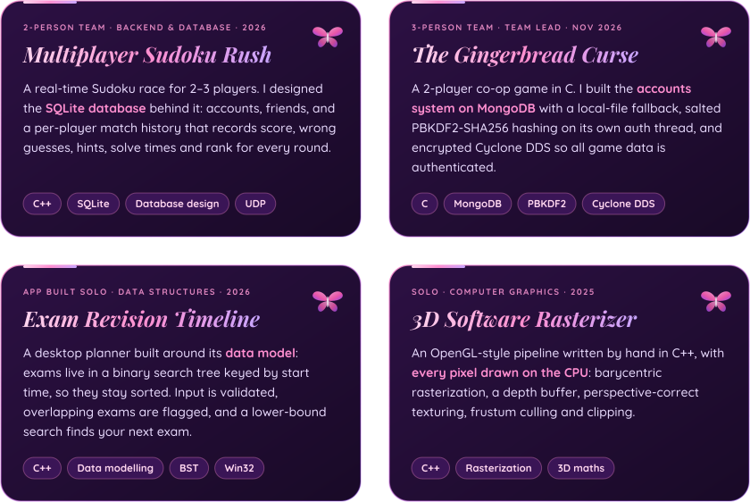

 

I build software that turns **real-world data** into something people can use: data pipelines and APIs, the databases behind multiplayer games, and real-time C/C++ for graphics and engines.
Next, I want to bring that into **data and business analysis**: taking raw data, structuring it, and turning it into answers.

<table>
<tr>
<td width="130" nowrap>🌸&nbsp;<b>Now</b></td>
<td>Visualisation &amp; Integration Lead on <b>Formula 9</b>, an autonomous shuttle fleet simulator (9-person team)</td>
</tr>
<tr>
<td width="130" nowrap>🎓&nbsp;<b>Studying</b></td>
<td>B.Sc. Computer Science in Real-Time Interactive Simulation, <b>SIT-DigiPen Singapore</b></td>
</tr>
<tr>
<td width="130" nowrap>✨&nbsp;<b>Strengths</b></td>
<td>Data pipelines &amp; REST APIs · database design (SQLite, MongoDB) · data modelling · Python, C/C++</td>
</tr>
<tr>
<td width="130" nowrap>💌&nbsp;<b>Open&nbsp;to</b></td>
<td>Internships in data analysis and business analysis</td>
</tr>
</table>

 

#### 🚐 Formula 9: Autonomous Shuttle Fleet Training Simulator
<b>9-person multidisciplinary team</b> · Visualisation &amp; Integration Lead · Sep 2026 to present

A Unity 3D simulator that trains autonomous-shuttle fleet managers on real Singapore streets: route planning, incident response and battery charging, then watching the fleet drive it out in 3D.

- **Unity port:** moved the earlier native client into Unity across 133 files, rebuilding 8 UI pages and the live fleet map on OpenStreetMap tiles.
- **3D city:** built Toa Payoh from 1,066 real buildings in 5 data-driven styles (HDB, office, low-rise, landed, other), with custom shaders, shadows, a procedural sky and 5 shuttles on colour-coded routes.
- **Procedural textures:** wrote a Unity editor tool that paints every building style from JSON using tileable fractal noise (windows, balconies, curtains, weathering) with matching normal maps, packed into 4 texture arrays. It replaced 10 hand-made PNGs, and restyling is now a one-click rebuild.
- **Charging, end to end:** Unity UI, FastAPI endpoints and JSON schemas for booking across 4 chargers, with overlap and conflict checks so a port is never double-booked. Also fixed a charging deadlock.
- **Road-detail pipeline:** data pipeline and REST API for 62 signalised junctions (683 signal heads), 151 crossings and 10,000+ road markings.

`Unity 6` `C#` `Python` `FastAPI` `JSON Schema` `pytest` `ShaderLab` `Procedural textures` `OpenStreetMap`

 

#### 🦉 Luminara Zoo
<b>8-person team (NocturnalStudios)</b> · Graphics Champion · Sep 2025 to Apr 2026

A night-shift point-and-click game where you keep four zoo animals fed, healthy and sane until 6 am. I built the rendering core of our own **custom C++ / OpenGL engine** across six milestones, as primary author of 12 engine files.

- **Engine setup:** built the engine from scratch, integrating 6 libraries (GLFW, GLEW, GLM, ImGui, STB, RapidJSON) into a CMake build that separates Engine and Game, with a one-click script so all 8 teammates could build it.
- **Renderer:** wrote the renderer, sprite rendering, shader, buffer and framebuffer classes and a 2D camera with zoom, plus a layering system with drag-to-reorder in the ImGui editor.
- **Particles &amp; VFX:** a JSON-driven particle and screen-effect system with 5 GLSL shaders (floating particles, falling leaves, water, static camera), each toggled per scene in the editor without code changes.
- **Shipping:** a Windows installer and uninstaller (Inno Setup) that bundles the release and its assets, refined over 3 versions until it installed cleanly on school lab PCs.

`C++` `OpenGL` `GLSL` `ECS` `ImGui` `RapidJSON` `CMake` `Inno Setup`

 

 

 

| | When | What I learned to build |
|:-:|:--|:--|
| 🦋 | Nov 2026 | Secure MongoDB accounts, as team lead (Gingerbread Curse) |
| ✨ | Sep 2026 | Data pipelines and APIs on real city data (Formula 9) |
| 🌸 | Mar 2026 | Designing a SQLite database for match history and stats (Sudoku Rush) |
| 🍃 | Feb 2026 | Modelling data so it stays sorted and searchable (Exam Timeline) |
| 🐛 | Sep 2025 | JSON-driven engine systems other programmers build on (Luminara Zoo) |
| 🥚 | May 2025 | A 3D pipeline by hand: what the GPU does for you |

 
Made with ♡ by Rishika

